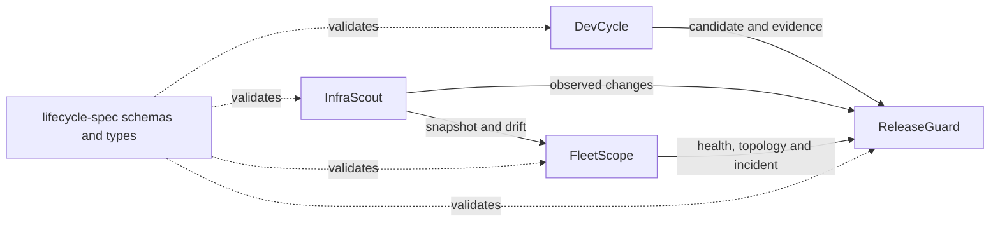

# lifecycle-spec

The open, versioned data contract that lets development, discovery, observability, and release tools collaborate without sharing private databases or importing each other's code.

[](https://github.com/GeneJie199/lifecycle-spec/actions/workflows/ci.yml)
[](LICENSE)

## Screenshot


The screen above is a real protocol consumer: requirements, acceptance checks, evidence, and the release candidate remain independently readable versioned documents.

## Why

The four Open Suite products must remain independently installable. Direct package imports or private-database access would turn them into one fragile application; lifecycle-spec instead defines portable JSON documents for resources, evidence, snapshots, changes, incidents, approvals, and releases.

## Core Features

- Versioned JSON Schema with positive and negative compatibility fixtures.
- Generated Go and TypeScript wire types with stable cross-platform contract hashes.
- A single embedded `lifecycle-validate` binary that works offline and outside the repository.
- Stable IDs, RFC 3339 timestamps, strict unknown-field handling, and redaction rules.
- Explicit producer/consumer contracts for DevCycle, InfraScout, FleetScope, and ReleaseGuard.
- Additive evolution: published v0.1 documents remain valid while new contracts receive distinct versions.

| Concept | Plain-language meaning |
|---|---|
| Resource | A host, service, port, repository, database, or other managed object |
| Snapshot | A normalized picture of state at one point in time |
| ChangeEvent | A traceable difference from earlier state |
| Evidence | A test, command, response, artifact, screenshot, or human confirmation |
| Event Envelope | Shared source, subject, and time metadata for an event |
| Infrastructure Drift | Observed infrastructure diverging from an accepted baseline or release intent |

## Quick Start

```bash
git clone https://github.com/GeneJie199/lifecycle-spec.git
cd lifecycle-spec
go test ./...
go build -o lifecycle-validate ./cmd/lifecycle-validate
./lifecycle-validate --schema release-candidate ./examples/v0.1/release-candidate.json
```

Run `./lifecycle-validate --list` to see every embedded schema. No current working directory, network access, Node runtime, or schema server is required.

## Online Install

The easiest route is the Open Suite one-command installer, which installs the validator, schemas, and all four products together:

```bash
curl -fsSL https://raw.githubusercontent.com/GeneJie199/ai-devops-open-suite/main/scripts/bootstrap.sh | bash
```

```powershell
irm https://raw.githubusercontent.com/GeneJie199/ai-devops-open-suite/main/scripts/bootstrap.ps1 | iex
```

For the validator alone, download `lifecycle-validate-<os>-<arch>` and `checksums.txt` from [Releases](https://github.com/GeneJie199/lifecycle-spec/releases/latest), verify the checksum, and place the binary on `PATH`.

## Offline Install

On an online machine, download the matching validator binary, `lifecycle-spec-<version>.tar.gz`, and `checksums.txt`. Move those files to the offline machine, verify SHA-256, then extract the schema archive. The Open Suite full offline bundle already contains these files and installs without reaching GitHub, a CDN, npm, or any other public dependency.

## First Five Minutes

1. Run `lifecycle-validate --list` to inspect available document kinds.
2. Validate `examples/v0.1/release-candidate.json`.
3. Copy the nearest example and change its IDs, timestamps, and business fields.
4. Validate the edited document before passing it to another product.
5. Read the matching schema and [integration contract](docs/integration-contracts.md) before adding custom fields.

## AI Optional

The protocol and validator contain no model integration and never need an AI provider. AI-assisted products may exchange documents through these contracts, but model output is still a proposal until deterministic checks or human evidence confirm it.

## Comparison

| Approach | Strength | lifecycle-spec's role |
|---|---|---|
| JSON Schema | Language-neutral validation | Uses Draft 2020-12 schemas as the normative wire contract |
| OpenAPI | HTTP endpoint description | Product APIs may use it; lifecycle-spec covers portable artifacts and events |
| Protobuf | Compact typed transport | Useful for high-throughput systems; not required for local file and HTTP JSON workflows |
| Shared internal models | Fast inside one monolith | Intentionally avoided so each product can release and operate independently |

## Architecture



Schemas are normative. Examples, generated types, and the embedded validator are checked against the same contract manifest in CI so line endings or code generation cannot silently change a published wire format.

## Security

- Secret-like fields and fixtures are rejected by contract tests; documents must not carry passwords, tokens, private keys, or raw business data.
- The validator reads only the user-selected local document and embedded schemas; it does not execute commands or make network requests.
- Unknown fields fail strict validation instead of being silently reinterpreted.
- Releases include SHA-256 checksums, CycloneDX SBOM, secret scanning, fuzz validation, and GitHub provenance.

Read [security and redaction](docs/security-and-redaction.md) and [SECURITY.md](SECURITY.md) before defining a document that could contain user data.

## Roadmap

Published protocol versions remain immutable. New resource and evidence kinds are added only with fixtures, generated types, compatibility tests, and an ADR when semantics change. See the [Open Suite roadmap](https://github.com/GeneJie199/ai-devops-open-suite/blob/main/ROADMAP.md).

## Contributing

Read [CONTRIBUTING.md](CONTRIBUTING.md). A schema change needs valid and invalid fixtures, synchronized Go/TypeScript types, compatibility coverage, updated producer/consumer documentation, and an ADR for a new core convention.

## Product Reference

### Defined Documents

| Schema | Producer to consumer |
|---|---|
| `project` / `requirement` / `acceptance-criterion` / `task` | DevCycle to automation agents and ReleaseGuard |
| `agent-session` / `code-change` | DevCycle to audit and evidence systems |
| `resource` / `relationship` / `snapshot` / `change-event` | InfraScout to FleetScope and ReleaseGuard |
| `monitoring-plan` / `monitoring-recommendation` | InfraScout to FleetScope native collection |
| `fleet-node-report` | FleetScope Agent to FleetScope Center and ReleaseGuard |
| `telemetry-batch` / `event-batch` | FleetScope Agent or compatibility adapters to FleetScope Center |
| `incident` | FleetScope to DevCycle, ReleaseGuard, and audit systems |
| `release-candidate` | DevCycle to ReleaseGuard |
| `expected-changes` | DevCycle or a release owner to ReleaseGuard |
| `release-validation-report` | ReleaseGuard to approval and archival systems |
| `evidence` / `approval` / `release` / `observation` | Shared lifecycle documents |

### Repository Layout

- Schemas: `schemas/v0.1/`
- Examples: `examples/v0.1/`
- Go types: `gen/go/lifecycle/v0_1/`
- TypeScript types: `gen/ts/v0.1/`
- Terminology: [docs/terminology.md](docs/terminology.md)
- Versioning: [docs/versioning.md](docs/versioning.md)
- Architecture: [docs/architecture.md](docs/architecture.md)
- ID conventions: [docs/id-conventions.md](docs/id-conventions.md)
- Integration contracts: [docs/integration-contracts.md](docs/integration-contracts.md)

Apache-2.0. Security reports follow [SECURITY.md](SECURITY.md).
